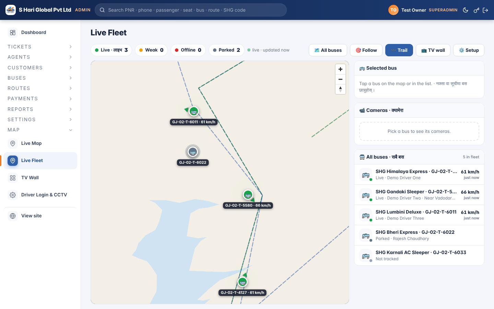
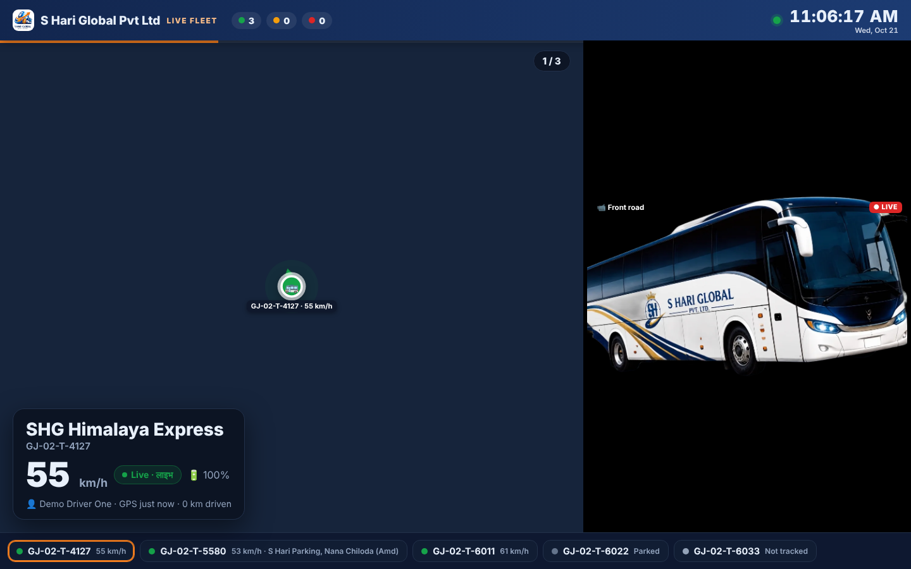
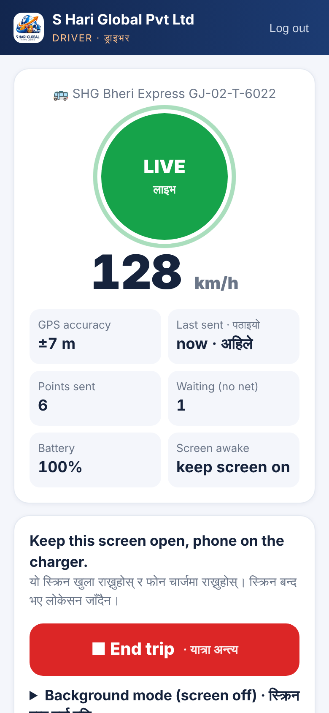

# 🛰️ Live Fleet — live bus tracking for shreehariglobal.in

Every bus on one map, **live, refreshed every second**, each from its own driver's phone.
Office staff watch it in the admin panel, on a phone, or full-screen on a **TV like a video channel**.
CCTV cameras can be added per bus later — the system is already built for them.

> **नेपालीमा:** ड्राइभरले आफ्नो मोबाइलमा **Driver ID + PIN** ले लगइन गर्छ → बस छान्छ → **Start trip** थिच्छ।
> त्यसपछि मोबाइलले हरेक सेकेन्ड GPS लोकेसन पठाउँछ। अफिसमा **Admin → Map → Live Fleet** मा सबै बस
> लाइभ देखिन्छ (हरेक सेकेन्ड रिफ्रेस)। **TV Wall** ले टिभीमा भिडियो जस्तै एक-एक बस घुमाएर देखाउँछ।
> पछि सीसी क्यामेरा जोड्न **Driver Login & CCTV** पेजमा लिंक हाल्ने मात्र हो।

| Admin — all buses live | TV wall — one bus at a time | Driver phone |
|---|---|---|
|  |  |  |

*(Screenshots are from the test setup, where internet map tiles were blocked — on the real site the map shows streets.)*

---

## 1. What you get

| Screen | Address | Who | What it does |
|---|---|---|---|
| **Driver app** | `/driver/` | driver's phone | Login with Driver ID + PIN → pick bus → Start trip. Sends GPS **every 1 s**. Keeps the screen awake. No internet? Keeps the points and sends them when the signal returns. |
| **Live Fleet** | `/admin/live-fleet.php` | staff (*schedules.view*) | All buses on one map, refresh **every 1 s**, smooth moving markers, status colours, speed, next stop, driver call/WhatsApp, trail, cameras. |
| **TV Wall** | `/admin/live-tv.php` | staff, or a TV with a private link | Full screen, dark. **One bus at a time** (rotates every 20 s, map follows the bus, CCTV beside it), **Grid** (every bus in its own tile) or **All** (whole fleet). |
| **Setup** | `/admin/live-setup.php` | manager / superadmin | Give drivers a Driver ID + PIN, see & sign out attached phones, add CCTV cameras, make the TV link. |

Status colours: 🟢 **Live** (GPS in the last 20 s) · 🟠 **Weak signal** (20 s – 3 min) · 🔴 **Offline** (trip running, no GPS for 3+ min) · ⚪ **Parked** (trip ended).

## 2. How it works (ground level)

```
 DRIVER PHONE (/driver/)                SERVER (PHP + MySQL)                    OFFICE / TV
 ───────────────────────                ────────────────────                    ───────────
 Driver ID + PIN  ── POST login ──▶  api/driver.php ─▶ fleet_driver_logins
                  ◀── token ───────  (new row in fleet_devices = "attached phone")
 Start trip       ── POST start ──▶  fleet_trips (status = running)
 GPS every 1 s    ── POST ping  ──▶  fleet_trips.last_lat/lng/speed  ◀── GET every 1 s ── admin/live-fleet.php
                                     fleet_points (trail, 1 per 5 s)     api/live-fleet.php  admin/live-tv.php
 End trip         ── POST end   ──▶  fleet_trips (status = ended)
```

- **Why 1-second polling and not WebSockets?** The site runs on normal PHP-FPM. A tiny JSON request every second
  (~1–2 KB) works on any hosting, through any firewall, with nothing extra to install or keep running.
- **Why does the marker move smoothly?** Between two GPS fixes the browser slides the bus over 1 second
  (`assets/livefleet/livefleet.js` → `_tick`), so it looks like video instead of jumping.
- **Phone screen must stay on.** A web page cannot read GPS when the phone is locked. The app keeps the screen awake.
  For true background tracking, the driver can install the free **Traccar Client** app — the driver page shows the
  two values to copy in (*Background mode*), and `api/fleet-osmand.php` accepts it.
- **The old Live Map still works.** While exactly one bus is live, Live Fleet also updates the old `livebus` value,
  so the passenger Trip Companion and "bus is near" alerts keep working.

What I found in the current website before building this: **[docs/RESEARCH.md](docs/RESEARCH.md)**.

## 3. Files (all NEW — nothing existing is replaced)

```
site/                                  ← copy into the website, same paths
├── database/upgrade-2026-10-live-fleet.sql   5 new tables (fleet_*) + 2 settings
├── includes/livefleet.php             the engine: login, trips, GPS, status, cameras, TV key
├── api/driver.php                     phone ↔ server (login / start / ping / end)
├── api/fleet-osmand.php               Traccar Client background tracking
├── api/live-fleet.php                 the 1-second map data for admin + TV
├── admin/live-fleet.php               Live Fleet page
├── admin/live-tv.php                  TV wall
├── admin/live-setup.php               Driver logins, phones, CCTV, TV link
├── driver/index.php                   the driver phone app (+ manifest.webmanifest)
├── assets/livefleet/livefleet.js|css  shared map + camera player code
├── cron/fleet-cleanup.php             hourly: end silent trips, delete old trail points
└── tests/live-fleet-test.php          77 engine checks
    tests/live-fleet-http-test.php     29 HTTP checks (phone → server → TV)
patches/admin-nav.patch                adds 3 menu items to admin/_guard.php (5 lines)
tools/install.sh                       copies site/ in + applies the patch
tools/test-local.sh                    builds a throw-away copy of the website and runs every test
tools/fleet-simulator.php              fake buses driving NH48, 1 fix/second (for testing)
tools/fleet-demo-seed.php              3 demo drivers DEMO1–3 / PIN 1234 (test copy only)
docs/CCTV.md                           how to connect bus cameras later
```

## 4. Install on the website (step by step)

> ⚠️ The website folder **is live** — every saved file is live immediately. Do it on a test copy first,
> take a backup, and follow the site's own `CLAUDE.md` rules.

```bash
# 0. backup (on the VPS)
cd /var/www/shreehariglobal.in/public_html
tar czf /root/backups/before-live-fleet-$(date +%F).tgz --exclude=uploads .

# 1. get this project and copy it in
git clone https://github.com/shreehariglobalpvtltd-a11y/studious-octo-engine.git /root/live-fleet
bash /root/live-fleet/tools/install.sh /var/www/shreehariglobal.in/public_html

# 2. database: 5 new tables (nothing existing changes)
php tests/apply-sql.php database/upgrade-2026-10-live-fleet.sql

# 3. hourly cleanup — crontab -e
17 * * * * php /var/www/shreehariglobal.in/public_html/cron/fleet-cleanup.php >/dev/null 2>&1

# 4. check
php -l includes/livefleet.php
curl -s -o /dev/null -w "%{http_code}\n" https://www.shreehariglobal.in/driver/     # 200
```

If you deploy through the `shreehari` GitHub repo instead: copy the `site/` files into that repo at the same
paths, apply `patches/admin-nav.patch` (`git apply patches/admin-nav.patch`), commit, and deploy as usual —
then run step 2 on the server.

## 5. First use (5 minutes)

1. **Admin → Map → Driver Login & CCTV**
2. In **Driver logins**, next to a driver: Driver ID (e.g. `D101`) + a PIN (🎲 makes one) → **Give login**.
   Tell the driver both. *(Driver must exist in Buses → Drivers & Crew first.)*
3. Driver scans the **QR code** on that page (or opens `https://www.shreehariglobal.in/driver/`), logs in,
   picks the bus, taps **▶ Start trip**, allows Location. Phone on the charger, screen on.
4. **Admin → Map → Live Fleet** — the bus appears within seconds. Tap it for speed, next stop, call driver.
5. **TV:** on the Setup page press **➕ Make TV link**, open that link on the office TV, press **⛶ Full screen**.

Lost phone? Set a new PIN for that driver (signs all their phones out) or press **Sign out** next to the phone.

## 6. Test it without a bus

On a **test copy** (never the live site — it would move real buses' dots):

```bash
# everything automatic: fresh copy of the website + test database + all tests
bash tools/test-local.sh            # needs php 8.3, MySQL/MariaDB, git

# or by hand, on a test copy that is already running (php -S 127.0.0.1:8899 -t .)
php tools/fleet-demo-seed.php /path/to/test-site          # DEMO1-3, PIN 1234
php tools/fleet-simulator.php --base=http://127.0.0.1:8899 \
    --driver=DEMO1:1234:1 --driver=DEMO2:1234:2 --driver=DEMO3:1234:3 --speedup=10
# now open /admin/live-fleet.php and /admin/live-tv.php — three buses drive along NH48
```

`--signal-loss=60` makes one bus lose signal for 25 s every minute (you will see 🟠 → 🟢 and the dot catch up).

What was tested (all passing):

| Check | Result |
|---|---|
| `tests/live-fleet-test.php` — login, lock-out, revoke, trips, GPS cleaning, trail, distance, status, next stop, cameras, TV key, cleanup | **77 / 77** |
| `tests/live-fleet-http-test.php` — real HTTP: phone API, map API auth, TV key, Traccar formats, pages | **29 / 29** |
| Real browser (Chromium): driver logs in on a phone screen → bus live on admin map; markers glide; TV focus / grid / all; camera tile; trip end | ✅ no console errors |
| Site's own suites after install: asset versions 9/9, admin security 27/27, ETA alerts 22/22 | ✅ |

## 7. Settings & limits

| Setting | Where | Default |
|---|---|---|
| Live / weak / offline thresholds | `LiveFleet::LIVE_SECONDS` / `WEAK_SECONDS` | 20 s / 3 min |
| Trail density | `LiveFleet::TRAIL_SECONDS` | 1 point per 5 s |
| Keep trail | Settings → `fleet_keep_days` | 30 days |
| Auto-end silent trips | `cron/fleet-cleanup.php` | after 6 h |
| PIN length, lock-out | `PIN_MIN/MAX`, `MAX_FAILS`, `LOCK_MINUTES` | 4–8 digits, 5 tries → 15 min |
| Admin refresh | `/admin/live-fleet.php?every=2` | 1 s |
| TV rotation | `/admin/live-tv.php?rotate=30` | 20 s |

## 8. CCTV later

Add a camera per bus in **Driver Login & CCTV → CCTV cameras** (HLS, MJPEG, snapshot or the DVR's web player).
Bus DVRs usually give `rtsp://…` — see **[docs/CCTV.md](docs/CCTV.md)** for turning that into a browser link with MediaMTX.
