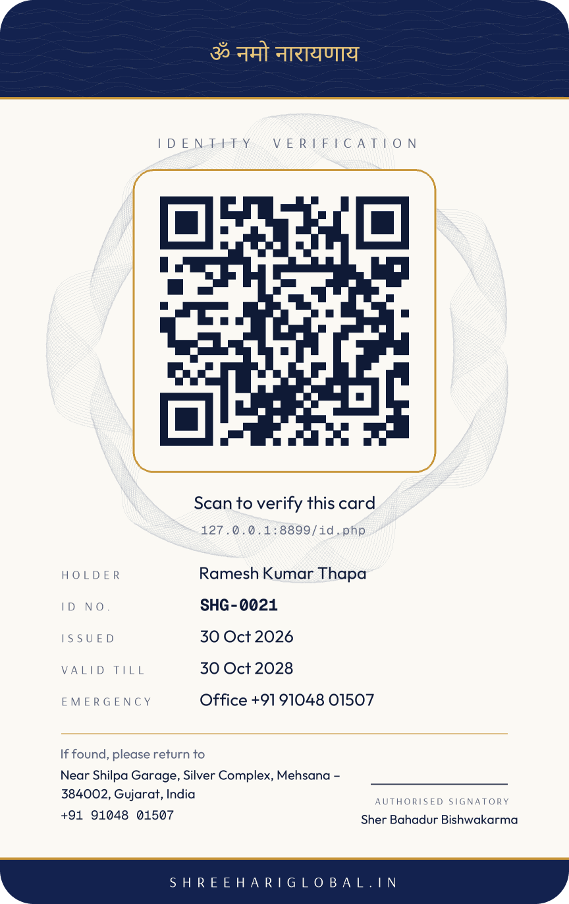

# Agent Pro — ID कार्ड, भिजिटिङ कार्ड, वालेट र WhatsApp डेस्क (सजिलो नेपालीमा)

हरेक **एजेन्ट र स्टाफ**को: प्रिमियम **ID कार्ड** (पछाडि QR — स्क्यान गर्दा "✓ VALID"), **भिजिटिङ कार्ड**
(`WA: +91 …` छापिएको, QR स्क्यान गर्दा सिधै WhatsApp च्याट खुल्छ), UPI जस्तै **वालेट** (withdraw, कम्पनीलाई पैसा
जम्मा), र आफ्नै मोबाइल पेज `/me/`। नयाँ एजेन्टले `/join.php` मा ५ मिनेटमा फारम भर्छ — Aadhaar / नागरिकताको
फोटो खिच्दा फारम **आफैं भरिन्छ**। अफिसले **एउटै बटन ✓ Approve** थिच्छ — कोड, ID कार्ड, लगइन सबै WhatsApp मा
आफैं जान्छ। WhatsApp बाट **नेपाली / हिन्दी / English** मा: ब्यालेन्स, स्टेटमेन्ट, टिकट काट्ने, टिकट सच्याउने।
AI चाहिए **तपाईंकै VPS** मा चल्ने **फ्री** मोडल (Ollama) — कुनै पैसा तिर्ने API छैन।

सबै फाइल **नयाँ** हुन् — पुरानो कुनै फाइल मेटिँदैन। जडान गर्दा दुई फाइलमा मात्र केही लाइन थपिन्छ
(`admin/_guard.php` मा मेनु, `includes/wabot.php` मा WhatsApp), र तिनको **ब्याकअप** (`….bak`) आफैं बन्छ।
सम्भव भए पहिले **टेस्ट कपी**मा गर्नुहोस्।

| ID कार्ड (अगाडि) | ID कार्ड (पछाडि — QR) | भिजिटिङ कार्ड |
|---|---|---|
|  |  |   |

## प्याकेजभित्र के छ

| फोल्डर | के हो |
|---|---|
| `1-upload-to-public_html/` | वेबसाइटको `public_html` भित्र अपलोड गर्ने फाइलहरू (उही फोल्डर संरचना) |
| `2-menu/` | हातैले गर्नुपरे: मेनुका लाइन (`AGENTPRO-MENU.txt`), WhatsApp का दुई हुक (`AGENTPRO-WABOT.txt`), patch फाइल |
| `3-database/` | डाटाबेसको SQL (९ नयाँ टेबल + सेटिङ) — installer ले आफैं चलाउँछ |
| `4-tools/` | SSH install स्क्रिप्ट, डेमो एजेन्ट, टेस्टका लागि नक्कली AI सर्भर, ब्राउजर टेस्ट |
| `docs/` | डिजाइन, कार्डको नमुना, स्क्रिनसट |

---

## चरण ० — ब्याकअप (अनिवार्य)

`public_html` को zip ब्याकअप र **phpMyAdmin → Export** बाट डाटाबेसको ब्याकअप लिनुहोस्।

## चरण १ — फाइल अपलोड

`1-upload-to-public_html` **भित्रका** सबै फोल्डर र फाइल (`admin`, `api`, `assets`, `cron`, `database`, `includes`, `me`,
`tests`, `join.php`, `id.php`, `c.php`) वेबसाइटको `public_html` मा अपलोड गर्नुहोस्। पहिलो पटक "Replace?" सोध्नु हुँदैन
(सबै नयाँ फाइल)। नयाँ संस्करण राख्दा भने **Replace**।

## चरण २ — एक क्लिकमा जडान ⚡

**super-admin** भएर खोल्नुहोस्:

```
https://www.shreehariglobal.in/admin/agentpro-install.php
```

**Install all** थिच्नुहोस्। यसले:
- डाटाबेसमा ९ नयाँ टेबल र सेटिङ थप्छ (पुरानो केही बदलिँदैन, दोहोर्‍याए पनि केही बिग्रिँदैन)
- मेनुमा **Control Center**, **Team & ID Cards**, **My ID & Wallet**, र Settings मा **AI (VPS) & WhatsApp** थप्छ
- `includes/wabot.php` मा WhatsApp डेस्कका दुई हुक थप्छ

हरेक लाइनमा ✓ देखियो भने सकियो। ✗ आयो भने त्यहीँ लेखेको कारण पढ्नुहोस्।

<details><summary>हातैले गर्ने तरिका (installer चलेन भने मात्र)</summary>

1. **मेनु:** `admin/_guard.php` मा `'Staff & Approvals'` भएको लाइनको **ठीक तल** `2-menu/AGENTPRO-MENU.txt` का पहिला ५ लाइन,
   र `'AI Activity'` भएको लाइनको तल अन्तिम लाइन पेस्ट गरेर Save।
2. **WhatsApp:** `2-menu/AGENTPRO-WABOT.txt` मा लेखे अनुसार `includes/wabot.php` मा दुई ठाउँमा।
3. **डाटाबेस:** phpMyAdmin → **Import** → `3-database/upgrade-2026-10-agent-pro.sql` → **Go**।
4. **SSH छ भने:** `bash 4-tools/agentpro-install.sh /var/www/shreehariglobal.in/public_html` (फाइल + मेनु + WhatsApp), र
   `cd public_html && php tests/apply-sql.php database/upgrade-2026-10-agent-pro.sql` (डाटाबेस)।
</details>

## चरण ३ — पृष्ठभूमिमा चल्ने worker (cron, हरेक मिनेट)

यसले ID को फोटो पढ्छ, ढिलो AI जवाफ पठाउँछ, पुराना ड्राफ्ट सफा गर्छ। `crontab -e` (वा hPanel → Cron Jobs):

```
* * * * * php /var/www/shreehariglobal.in/public_html/cron/agentpro-worker.php >/dev/null 2>&1
```

(फोल्डरको ठेगाना installer पेजले देखाउँछ।) ID फोटोबाट अक्षर पढ्न (ऐच्छिक, तर राम्रो):

```
apt install tesseract-ocr tesseract-ocr-hin tesseract-ocr-nep
```

## चरण ४ — नयाँ एजेन्ट: फारम र एक बटन Approve ✓

1. यो लिङ्क WhatsApp मा पठाउनुहोस्: **`https://www.shreehariglobal.in/join.php`** (वा WhatsApp मा कसैले *join* लेख्यो भने आफैं जान्छ)।
2. एजेन्टले ६ चरणमा भर्छ: **को हो** (एजेन्ट / एजेन्सी) → **WhatsApp प्रमाणित** (OTP, वा "WhatsApp बाट verify" थिच्दा
   `JOIN 123456` आफैं लेखिएर जान्छ) → **ID को फोटो** (Aadhaar को QR ले नाम, जन्ममिति, ठेगाना आफैं भर्छ; नागरिकता / PAN /
   Voter / Licence / Passport फोटोबाट पढिन्छ) → **सेल्फी** (यही फोटो ID कार्डमा जान्छ) → **बैंक / UPI** (ऐच्छिक) → **Submit**।
   अगाडि-पछाडि फोटो, औंठाछाप र थप कागजात पनि राख्न मिल्छ।
3. अफिसमा: **Admin → Control Center** मा "applications waiting" → **✓ Approve** — एक थिचाइ। आफैं हुन्छ:
   एजेन्ट कोड (SHG-00xx), खाता सक्रिय, KYC verified, सेल्फी = प्रोफाइल फोटो, ID र भिजिटिङ कार्ड, र WhatsApp मा स्वागत
   सन्देश (कोड + `/me/` लगइन)। मिलेन भने कारण लेखेर **✕ Reject** — कारण WhatsApp मा जान्छ।
4. स्टाफ थप्नु छ भने: **Team & ID Cards → Invites** मा भूमिका छानेर लिङ्क बनाउनुहोस्।

## चरण ५ — तपाईंकै VPS मा फ्री AI (ऐच्छिक, तर सिफारिस)

AI नभए पनि सबै चल्छ (WhatsApp डेस्कका कमान्ड, फारम, कार्ड)। AI ले थप्ने कुरा: बोलीचालीको सन्देश बुझ्ने
(*"bholi mehsana ko 2 ta seat ram thapa lai"*), नागरिकता जस्ता QR नभएका कार्डको फोटो पढ्ने, यात्रुलाई जवाफ दिने।

```
curl -fsSL https://ollama.com/install.sh | sh
ollama pull qwen3.5:4b
```

VPS को RAM अनुसार कुन मोडल:

| RAM | मोडल | किन |
|---|---|---|
| ४–६ GB | `qwen3.5:2b` | सानो, छिटो; नेपाली साधारण |
| **८ GB** | **`qwen3.5:4b`** | **सिफारिस** — च्याट, टुल र ID फोटो पढ्ने एउटै मोडलमा |
| १६ GB | `qwen3.5:9b` | नेपाली / हिन्दी धेरै राम्रो; CPU मा 4b भन्दा करिब दोब्बर ढिलो |
| ३२ GB+ | `qwen3.5:9b` + `gemma4:e4b` | कागजातका लागि दोस्रो राय |

त्यसपछि **Admin → Settings → AI (VPS) & WhatsApp**: पेजले VPS को RAM हेरेर मोडल सिफारिस गर्छ। **Use the AI on this VPS**
अन गर्नुहोस् → **Run 5 tests** (नेपाली, रोमन नेपाली, हिन्दी, English) थिचेर हेर्नुहोस्। CPU मा AI को जवाफ ३०
सेकेन्डदेखि १ मिनेटसम्म लाग्न सक्छ — त्यतिबेला "⏳ एकछिन…" सन्देश आफैं जान्छ। **टिकट AI को अनुमानमा कहिल्यै
काटिँदैन:** पहिले मूल्य सहितको विवरण आउँछ, एजेन्टले **ho** लेखेपछि मात्र, र मूल्य सधैं सिस्टमबाट।

> Ollama को लागि VPS चाहिन्छ (Hostinger को साधारण shared hosting मा चल्दैन)। मोडल अर्को सर्भरमा छ भने त्यसको ठेगाना
> (जस्तै `http://10.0.0.5:11434`, वा OpenAI-जस्तो `/v1` सर्भर) सोही पेजमा राख्नुहोस्।

## चरण ६ — WhatsApp डेस्क (एजेन्ट र स्टाफ)

**एक पटक जोड्ने:** एजेन्टले कम्पनीको WhatsApp मा लेख्छ **`LINK SHG-0027`** → ६ अङ्कको OTP उसको **दर्ता भएको मोबाइल**मा
जान्छ → त्यही ६ अङ्क WhatsApp मा पठाउँछ → जोडियो। दर्ता भएकै नम्बरबाट लेखे LINK चाहिँदैन।

| लेख्ने | के हुन्छ |
|---|---|
| `help` / `namaste` | मेनु |
| `balance` / `baki` | कमिसन, कम्पनीको नगद, यो महिनाको कमाइ |
| `statement` / `hisab` | पछिल्ला कारोबार + PDF लिङ्क |
| `withdraw 2000` / `nikal 2000` | निकाल्ने अनुरोध (**ho** लेखेपछि मात्र) |
| `jama 1500 UTR 412345678901` | कम्पनीलाई तिरेको पैसा — अफिसले बैंकमा मिलाएर ✓ |
| `id card` / `id back` · `visiting card` | आफ्नो कार्ड फोटोमा |
| `me` | आफ्नो विवरण |
| `office` | ठेगाना, CIN, काउन्टरका नम्बर |
| `contacts` · `number of Ram` | अफिस / टिमका नम्बर |
| `bus` · `bus bholi` | आज / भोलिका बस, गाडी नम्बर, लाइभ लिङ्क |
| `aaja` · `passengers bholi` | आजको बिक्री · भोलिका यात्रु |
| `2 सिट भोलि Mehsana, Ram Thapa 98XXXXXXXX` | **टिकट** — पहिले मूल्य, **ho** लेखेपछि काटिन्छ, कमिसन वालेटमा |
| `SHG-… नाम Sita Thapa` | टिकट सच्याउने (pickup / seat / phone / date पनि) — पहिले देखाउँछ, **ho** मा लागू |
| `SHG-… cancel` · `SHG-… resend` | रद्द · टिकट फेरि पठाउने |
| `nepali` / `hindi` / `english` | भाषा फेर्ने (सन्देशको भाषा आफैं पनि चिन्छ) |

## एजेन्टको आफ्नै पेज — `/me/` 📱

**एजेन्ट कोड + मोबाइल → WhatsApp OTP** ले लगइन। एक पटक **🔐 fingerprint / face sign-in** अन गरेपछि OTP चाहिँदैन
(फोनकै औंठाछाप / अनुहार — वेबसाइटले औंठाछाप कहिल्यै देख्दैन, फोनले मात्र जाँच्छ)। होम स्क्रिनमा एप जस्तै राख्न मिल्छ।

- **ID** — कार्ड थिच्दा पछाडि घुम्छ; डाउनलोड, प्रिन्ट, verify लिङ्क
- **Card** — भिजिटिङ कार्ड; **WhatsApp नम्बर**, ट्यागलाइन, स्वागत सन्देश, रङ (Royal / Gold / Night) आफैं फेर्ने — कार्ड तुरुन्त नयाँ
- **Wallet** — Paytm / PhonePe जस्तै: ब्यालेन्स, **Withdraw**, **Pay company** (रकम लेख्दा UPI QR बन्छ), Statement, पासबुक
- **Docs** — आफ्ना KYC कागजात
- **Profile** — फोटो फेर्ने (ID कार्डको फोटो पनि उही), बैंक / UPI / eSewa, fingerprint, जोडिएका WhatsApp नम्बर

## अफिसमा दैनिक काम

- **Control Center** — आजका टिकट, approve गर्न बाँकी, withdraw, जम्मा, KYC, लाइभ बस; सबै मेनु श्रेणी अनुसार कार्डमा।
  मोबाइलमा पनि उस्तै।
- **Team & ID Cards** — *Approvals* · *Agents* · *Staff* · *Money* (withdraw ✓ Paid एक थिचाइमा, जम्मा ✓ Confirm) ·
  *Print cards* (A4 मा ३०० dpi, अगाडि-पछाडि मिल्ने गरी) · *Invites*।
- सदस्यको पेज: कार्ड **Re-issue** (हराए), **Suspend** (QR स्क्यान गर्दा "SUSPENDED" देखिन्छ), WhatsApp मा कार्ड पठाउने।

## सुरक्षा र नियम

- Aadhaar नम्बर **XXXX XXXX 1234** मात्र राखिन्छ (UIDAI नियम)। कागजात साइटकै KYC फोल्डर `uploads/agents-kyc/` मा अनुमान गर्न
  नसकिने नाममा बस्छन्, कहीँ लिङ्क हुँदैनन्, र अफिसका मान्छेले लगइन गरेर मात्र हेर्छन्। अझ बलियो बनाउन nginx मा यो एक
  लाइन थप्नुहोस् (त्यो फोल्डर सिधै खोल्नै नमिल्ने): `location ^~ /uploads/agents-kyc/ { deny all; }`
- बैंक खाता इन्क्रिप्ट गरेर राखिन्छ। OTP, फारम, WhatsApp सबैमा दर (rate) सीमा।
- ID कार्डको QR ले `id.php` खोल्छ — VALID / SUSPENDED / EXPIRED / REVOKED, कम्पनीको CIN र ठेगाना सहित।

## टेस्ट (टेस्ट कपीमा मात्र)

```
bash tools/test-local.sh            # वेबसाइटको नयाँ कपी + टेस्ट डाटाबेसमा Live Fleet + Agent Pro, सबै टेस्ट
BROWSER=1 bash tools/test-local.sh  # Chrome मा पूरा यात्रा पनि: फारम → approve → /me/
```

## हटाउनु परे

`admin/_guard.php` र `includes/wabot.php` को `….agentpro-….bak` ब्याकअप फर्काउनुहोस्। नयाँ फाइल र `ap_` टेबल भए पनि
केही बिग्रिँदैन (कसैले प्रयोग गर्दैन)।
